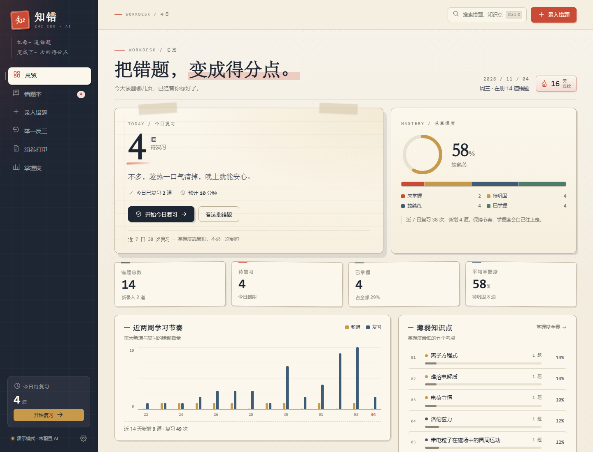
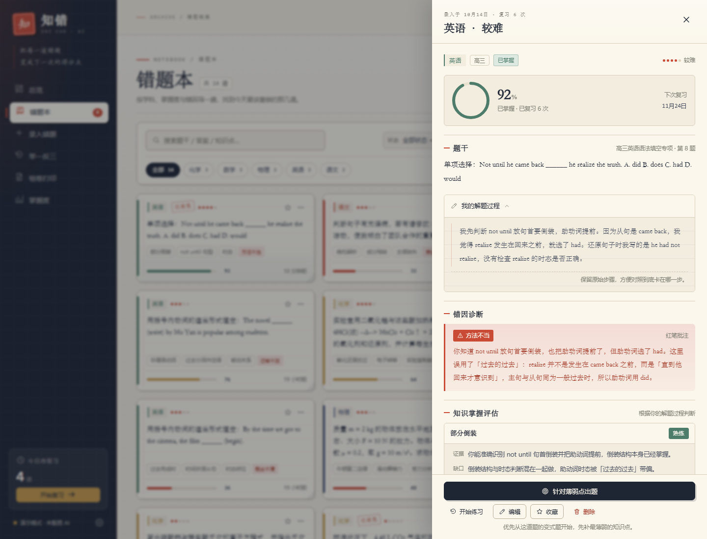
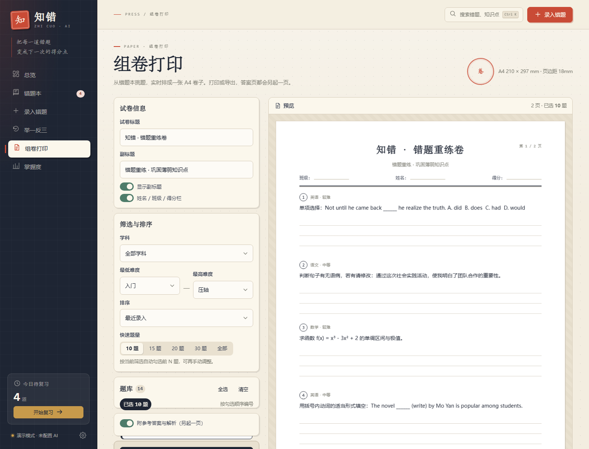
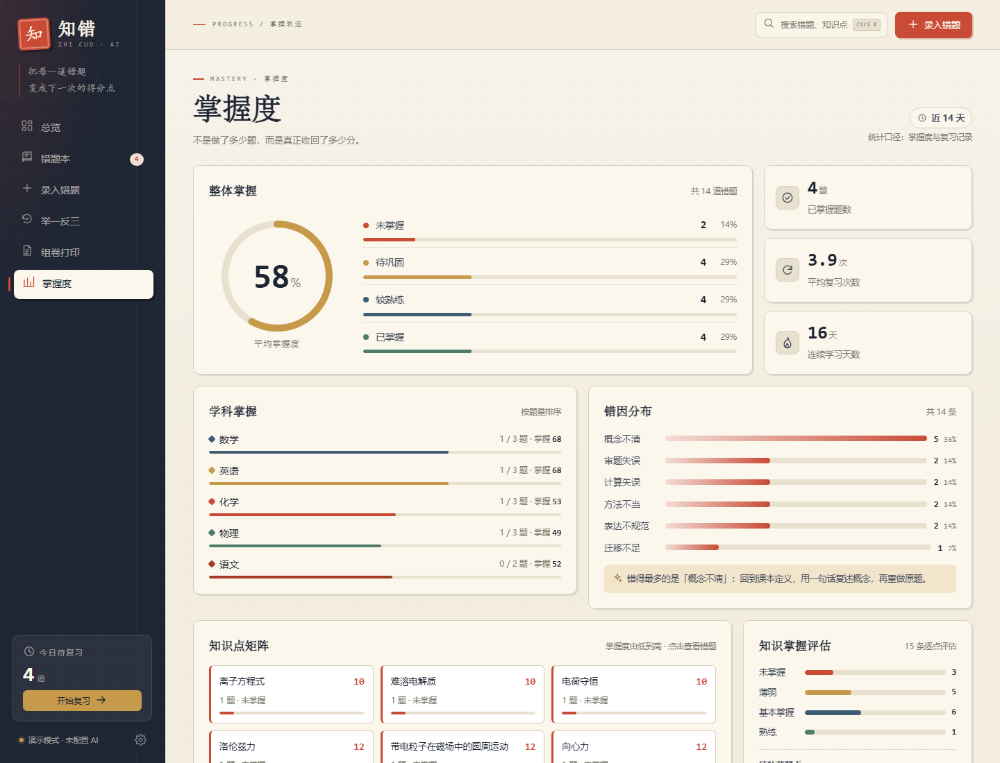
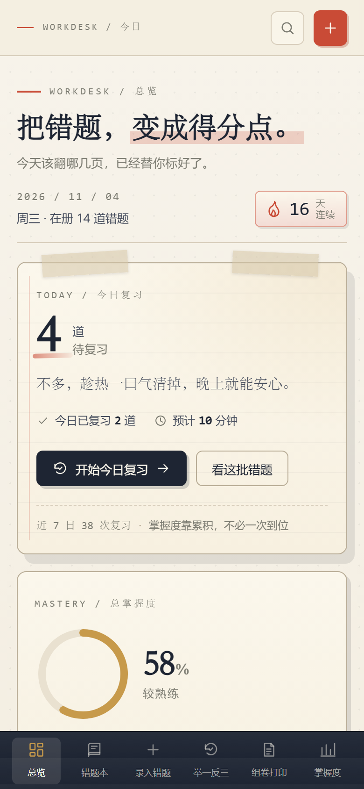
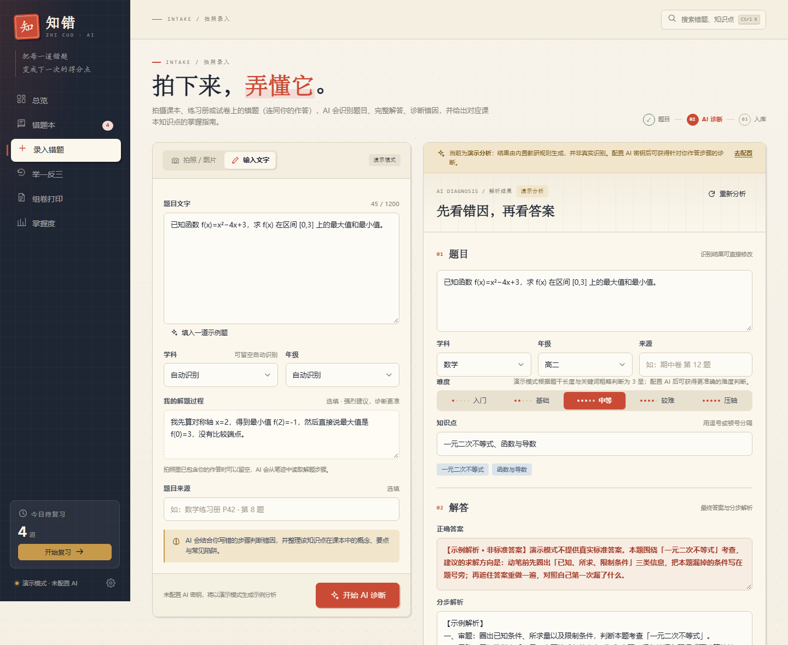

# 知错 · AI 智能错题本

> 把每一道错题，变成下一次的得分点。

拍照或输入题目，AI 完成**识题、解答、错因诊断、知识点掌握评估、课本掌握指南、举一反三**；之后可以在错题本里管理、按薄弱点练习、组卷打印，并持续追踪掌握度。手机、平板、桌面浏览器均可使用。

> **Android 本地优先版（0.4.0，模拟器已验证）**：`android/` 目录已包含原生 Kotlin + Compose MVP，错题、照片、练习记录全部存手机本地，AI 仅分析时联网。APK 下载：[GitHub Release](https://github.com/milelee0/zhicuo/releases/download/v0.4.0/zhicuo-android-0.4.0.apk) ｜ <https://zhicuo.tseril.xyz/downloads/zhicuo-android-0.4.0.apk>。已在 Android 15 模拟器验证启动、错题本/详情、拍照录入、AI 请求链路、PDF 导出、练习自评与清空示例（见 [运行验证报告](docs/android-runtime-check.md)）；真机拍照与真实 AI 识别待试用确认。构建与配置见 [android/README.md](android/README.md)。



## 目录

- [功能一览](#功能一览)
- [快速开始](#快速开始)
- [配置 AI](#配置-ai)
- [使用流程](#使用流程)
- [技术架构](#技术架构)
- [数据与隐私](#数据与隐私)
- [测试](#测试)
- [目录结构](#目录结构)
- [已知边界](#已知边界)

## 功能一览

| 模块 | 能力 |
|---|---|
| 📷 拍照录入 | 手机系统相机 / 浏览器摄像头 / 图片上传 / 拖拽 / 粘贴截图；照片可同时包含题干与学生手写作答 |
| 🧠 AI 诊断 | 识别题干→完整解答→判断错因类型（概念不清/审题失误/计算失误/方法不当/迁移不足/表达不规范）→结合学生解题步骤给出知识掌握评估与微型讲解 |
| 📚 课本掌握指南 | 每个核心知识点输出：概念复述、必须掌握的要点、常见陷阱、自检清单 |
| 📓 错题本 | 搜索、学科/状态/难度/错因/收藏筛选、排序、详情抽屉、编辑、删除、原图查看、练习记录 |
| 🔁 举一反三 | 每道错题配 2 道变式题（标注针对知识点）；按今日复习/薄弱攻坚/随机/学科模式练习，自评后自动更新掌握度与复习时间 |
| 📄 组卷打印 | 从题库勾选或按条件自动组成 A4 试卷，实时预览、姓名班级栏、答题留白、答案与解析另起一页，支持浏览器打印 |
| 🖼 PDF / 图片导出 | 不依赖第三方库，把「易错题 + 变式题 + 答案 + 掌握指南」生成 A4 PDF 或 PNG 练习册，适合反复练 |
| 📈 掌握度跟踪 | 总掌握度环、四档分布、学科掌握、知识点矩阵、错因分布、近 14 天节奏、未来 7 天复习预测、逐知识点掌握评估汇总 |
| 🎯 针对性建议 | 依据解题过程，指出「错在哪一步、缺哪个概念、下一步补什么」，并给出针对薄弱点的练习入口 |
| 📱 响应式 | 桌面侧栏 → 手机底部导航；所有页面移动端可用；A4 打印样式独立 |

### 界面预览

| 错题详情：错因诊断 + 掌握评估 + 掌握指南 | 组卷打印：A4 实时预览 |
|---|---|
|  |  |

| 掌握度：薄弱点一目了然 | 手机端 |
|---|---|
|  |  |

## 快速开始

环境要求：**Node.js 20+**（推荐 24），无需 `npm install`，没有任何第三方依赖。

```powershell
# 方式一：双击 start.cmd（Windows）
# 方式二：命令行
node server/index.mjs
```

打开 **http://127.0.0.1:8787**。

首次启动会自动从 `data/seed.json` 播种 14 道真实高中错题，直接就能体验完整流程。想重置演示数据：

```powershell
Remove-Item data/db.json          # 停止服务后执行
node server/index.mjs             # 重新播种
```

修改端口：`$env:PORT=9000; node server/index.mjs`。

### 手机访问

手机和电脑连接同一个 Wi-Fi 后：

```powershell
# 方式一：双击 start-lan.cmd
# 方式二：命令行
$env:HOST='0.0.0.0'; node server/index.mjs
```

启动日志会打印「手机访问」地址，例如：

```
➜  手机访问：http://10.152.126.116:8787  （同一 Wi-Fi · WLAN）
```

在手机浏览器打开这个地址即可。注意：

- 默认 `node server/index.mjs` 只监听本机 `127.0.0.1`，手机无法访问；必须使用 `start-lan.cmd` 或设置 `HOST=0.0.0.0`。
- 电脑需要允许 Node.js 通过防火墙（首次启动通常系统会询问；本机已有 Node.js 入站规则）。
- 手机端底部导航会自动切换；拍照时直接点「拍照 / 图片」区域会调起系统相机。
- 局域网 HTTP 下浏览器不允许网页直接调用摄像头预览，因此「打开摄像头」会自动回退到系统相机，不影响拍照录入；如需网页内实时取景，需要使用 HTTPS。
- 开启后同一局域网内的设备都能访问，请只在可信 Wi-Fi（家中/个人热点）使用，并在用完后按 Ctrl+C 关闭服务。应用本身没有登录鉴权。

### Android 原生版（local-first）

手机安装 `zhicuo-android-0.4.0.apk` 后：错题、照片、练习记录全部在手机本地，只有拍照识别那一刻会把图片临时发给所选 AI 服务商。

1. 安装 APK（首次需允许「安装未知应用」）；
2. 打开 App →「设置」→ 选服务商（推荐通义千问）→ 选 `qwen-vl-max` → 填 API Key → 保存；
3. 「录入」→ 拍照（题干 + 手写作答一起拍）→ AI 识别/解答/错因诊断 → 保存到错题本；
4. 「练习」做变式题并三档自评，掌握度与下次复习时间自动更新；
5. 「设置」可导出全部错题 PDF（含答案解析）、清空内置示例题。

在线下载：[GitHub Release](https://github.com/milelee0/zhicuo/releases/download/v0.4.0/zhicuo-android-0.4.0.apk) ｜ <https://zhicuo.tseril.xyz/downloads/zhicuo-android-0.4.0.apk>（均无需登录）。运行验证记录见 [docs/android-runtime-check.md](docs/android-runtime-check.md)。

### 照片存在哪里

- **本地 Node 版**：原始照片保存在这台电脑的 `data/uploads/`，和 `data/db.json` 一起属于本机数据。
- **Cloudflare 版**：题目、答案、掌握度、练习记录在 Cloudflare D1；**照片原图只保存在当前浏览器的 IndexedDB 中，不会上传到 D1/云存储**（AI 识别时会临时发给 AI 服务商）。
- 因此：换设备、换浏览器或清理浏览器站点数据后，旧照片不会跟随；但题目与学习记录仍在。需要照片跨设备同步时，可改用 R2 存储。
- 本地版换电脑时，把 `data/db.json` 和 `data/uploads/` 一起复制即可；便携包已包含当前数据。

### 换电脑 / 异地使用

这是一个**单机本地应用**：电脑关机后，手机上的局域网地址会失效，但数据仍保存在这台电脑的 `data/db.json`（题目、掌握度、练习记录、设置）与 `data/uploads/`（错题原图）中，不会丢失。

想在别处继续用，有三种方式：

1. **换另一台电脑（最简单，数据完整）**
   - 把整个 `D:\AI\cuotiben` 文件夹（或本地生成的便携包 `dist/zhicuo-portable-*.zip`）复制到新电脑；
   - 新电脑安装 Node.js 20+；
   - 解压后运行 `start.cmd`（本机）或 `start-lan.cmd`（手机访问）。
   - `data/db.json` 和 `data/uploads/` 一起带走即可保留所有错题与练习记录。便携包已包含当前 14 道示例数据。

2. **部署到云服务器 / NAS / 常开小主机（真正随时随地）**
   - 在任意有 Node.js 20+ 的 Linux/Windows 主机上放置本项目，运行 `HOST=0.0.0.0 node server/index.mjs`；
   - 推荐用 Nginx/Caddy 反向代理 + HTTPS + 访问密码，因为应用本身没有登录鉴权；
   - 之后手机、平板、任何电脑都能通过公网地址访问。
   - 迁移数据：把旧电脑的 `data/db.json`、`data/uploads/` 复制到新主机对应目录。

3. **远程使用家里这台电脑（电脑必须保持开机）**
   - 安装 Tailscale / ZeroTier 等组网工具，手机和电脑加入同一虚拟网络；
   - 电脑运行 `start-lan.cmd`，手机用虚拟网络 IP 访问；
   - 优点是不用迁移数据；缺点是电脑关机后不可用，无法满足「电脑已关机」的情况。

4. **部署到 Cloudflare（推荐，真正随时随地）**
   - 已提供 Workers + D1 版本：前端复用 `public/`，后端在 `cloudflare/worker.mjs`，题目/练习/设置存在 Cloudflare D1；照片原图只存当前浏览器 IndexedDB，不上传云端；自带密码登录；
   - 一次部署后任何设备都能通过 `https://zhicuo.<你的子域>.workers.dev` 访问，不再依赖这台电脑；
   - 详见 [cloudflare/README.md](cloudflare/README.md)，最短流程：

   ```powershell
   npm install
   npm run cf:login
   node scripts/cf.mjs d1 create zhicuo   # 把返回的 database_id 填进 wrangler.toml
   npm run cf:migrate
   node scripts/cf.mjs secret put APP_PASSWORD
   npm run cf:deploy
   ```

> 安全提醒：本地版默认没有登录鉴权；Cloudflare 版通过 `APP_PASSWORD` 保护。`data/db.json` 里可能包含你的 AI API Key，复制、上传网盘或发给别人前请先确认。

## 配置 AI

不配置密钥也能使用：应用运行在**演示模式**，AI 分析由内置教研规则生成，并明确标注「示例分析」；拍照识别会被拒绝并提示配置视觉模型（不伪造识别结果）。

配置真实 AI：

1. 打开 **设置 → AI 服务**；
2. 填写 OpenAI 兼容接口：

   | 字段 | 示例 | 说明 |
   |---|---|---|
   | API 地址 | `https://api.deepseek.com/v1` | 会自动拼接 `/chat/completions`，带不带 `/v1` 均可 |
   | 文本模型 | `deepseek-chat` / `qwen-plus` / `gpt-4o-mini` | 解题、错因、变式题 |
   | 视觉模型 | `qwen-vl-max` / `gpt-4o` | **拍照识题必需**；不填则识别图片会被拒绝 |
   | API Key | `sk-...` | 仅保存在本机 `data/db.json` |

3. 点击「保存设置」→「测试连接」。

支持的提供方：DeepSeek、通义千问（DashScope 兼容模式）、Moonshot、OpenAI，以及任何 OpenAI Chat Completions 兼容服务。

也可以用环境变量（页面未显式保存配置时生效）：

```powershell
$env:AI_API_KEY='sk-...'
$env:AI_BASE_URL='https://api.deepseek.com/v1'
$env:AI_MODEL='deepseek-chat'
$env:AI_VISION_MODEL='qwen-vl-max'
$env:AI_MOCK='1'        # 强制演示模式
node server/index.mjs
```

## 使用流程

### 1. 录入一道错题

- **拍照 / 图片**：拍摄课本、练习册、试卷。建议把题干和**自己的错误作答/步骤**一起拍进去。
- **输入文字**：粘贴题目，并在「我的解题过程」里写下当时的思路、答案或卡住的地方（可选，但会显著提升诊断准确度）。
- 可补学科、年级、来源。

### 2. 看 AI 诊断

点击「开始 AI 诊断」后，依次得到：

1. **题目与解答**：识别文字、正确答案、分步解析、易错点；
2. **错因诊断**：错因类型 + 结合你具体步骤的错因剖析 + 掌握指导；
3. **知识掌握评估**：逐知识点给出「未掌握 / 薄弱 / 基本掌握 / 熟练」，并引用你解题过程中的证据、指出知识缺口、给 2–4 句微型讲解；
4. **下一步针对性建议**：先补哪个概念、重做哪一步、做什么题；
5. **课本掌握指南**：概念、要点、陷阱、自检清单；
6. **举一反三**：2 道变式题，可勾选一并入库。

所有内容都可以在入库前修改；确认后保存到错题本。



### 3. 错题本复习

- 按学科、状态、难度、错因、收藏筛选，或直接搜索题干/答案/知识点；
- 点开任意题卡，查看错因、掌握评估、解题过程、答案、掌握指南与变式题；
- 底部「针对薄弱点出题」会带着这道题进入变式练习。

### 4. 举一反三

- 四种模式：今日复习（按遗忘曲线到期）、薄弱攻坚（掌握度最低）、随机抽练、按学科；
- 先看提示，再查看答案，最后自评「已掌握 / 有点模糊 / 还是不会」：
  - 已掌握 +16 分，有点模糊 +4 分，还是不会 −8 分；
  - 自动调整 status、复习次数与下一次复习时间（1/2/4/7/15/30 天）。

### 5. 组卷打印 / 导出

- 「组卷打印」：筛选题目 → 勾选 → A4 实时预览 → 浏览器打印（含答案页分页）；
- 「举一反三 → 导出练习册」或「组卷 → 导出 PDF / 图片」：生成 A4 PDF 或 PNG，适合发到手机、打印或反复练。

### 6. 掌握度跟踪

总览与掌握度页展示掌握分布、学科掌握、知识点矩阵、逐知识点掌握评估、错因分布、学习节奏与未来 7 天复习预测，帮助决定「今天先弄懂哪几道」。

## 技术架构

```
浏览器（原生 ES Modules，无框架、无构建）
   ├─ 视图层：总览 / 错题本 / 录入 / 举一反三 / 组卷 / 掌握度 / 设置
   ├─ Canvas 导出：A4 排版 → PNG / 图像页 PDF（无第三方库）
   └─ fetch ──► Node HTTP 服务（零依赖）
                  ├─ REST API
                  ├─ JSON 持久化（原子写入 data/db.json）
                  ├─ 图片存储（data/uploads/）
                  └─ AI 引擎：OpenAI 兼容 live + 内置 demo 规则引擎
```

- **前端**：原生 ES Modules + CSS 设计系统（纸张/墨色/朱批），无 CDN、无外部字体与图片，离线也能渲染界面。
- **后端**：仅使用 Node 内置模块（`http`/`fs`/`path`/`crypto`），单进程本地服务。
- **Cloudflare 版**：同一套前端 + `cloudflare/worker.mjs` + D1；AI 引擎和 demo 规则复用 `server/ai.mjs`，静态资源由 Workers Assets 提供，密码登录使用 HMAC 签名 Cookie；照片使用浏览器 IndexedDB 本地存储，云端只保存题目元数据。
- **持久化**：本地为 `data/db.json`（临时文件 + rename 原子落盘）；Cloudflare 为 D1（`questions` / `settings` / `images` 三张表）。
- **AI 调用**：OpenAI Chat Completions 兼容协议；视觉题使用 `image_url` content；要求模型输出严格 JSON，服务端做围栏/括号解析、字段归一化、失败重试。
- **掌握度算法**：自评驱动 mastery 分数、status 与复习间隔；`due` 与 7 天复习预测基于 `nextReviewAt`。

### 主要 API

| 方法 | 路径 | 作用 |
|---|---|---|
| GET | `/api/health` `/api/bootstrap` `/api/stats` | 健康检查、初始化数据、统计 |
| GET/POST | `/api/questions` | 列表（筛选/搜索）与新建 |
| GET/PATCH/DELETE | `/api/questions/:id` | 单题读取、更新、删除 |
| POST | `/api/analyze` | AI 识题、解答、错因、掌握评估、变式题 |
| POST | `/api/questions/:id/attempts` | 练习自评，更新掌握度 |
| POST | `/api/questions/:id/variants` | 按薄弱点补充变式题 |
| GET | `/api/practice/queue` | 练习队列（due/weak/random/subject） |
| GET/PUT | `/api/settings` | AI 配置（密钥脱敏） |
| POST | `/api/ai/test` | 测试 AI 连接 |
| GET | `/api/export` | 导出全部数据 JSON |

详细字段与模块契约见 [BUILD_CONTRACT.md](BUILD_CONTRACT.md)。

## 数据与隐私

- 所有错题、图片、设置都保存在本机 `data/`，没有云端账号，也不会上传到本项目之外。
- API Key 只写入本机 `data/db.json`，`GET /api/settings` 只返回 `hasKey`，不返回明文。
- AI 请求只会发往你在设置里填写的服务地址。
- 备份：设置页「导出全部数据」下载 JSON；或直接复制 `data/db.json` 与 `data/uploads/`。
- `.gitignore` 已排除 `data/db.json`、`data/uploads/`，避免误提交个人数据。

## 测试

服务启动后：

```powershell
node scripts/smoke.mjs        # API 冒烟：28 项（CRUD / 分析 / 掌握度 / 图片 422 / 静态资源）
node scripts/ui-check.mjs     # 浏览器 UI：23 项（需 Edge/Chrome；自动校验各路由、抽屉、分析入库、打印样式、导出 PDF/PNG、移动端）
node scripts/cf-smoke.mjs http://127.0.0.1:8788 test123   # Cloudflare Worker + D1：27 项
```

`ui-check.mjs` 需要自行准备 CDP 浏览器，例如：

```powershell
$edge='C:\Program Files (x86)\Microsoft\Edge\Application\msedge.exe'
$p=Start-Process $edge -ArgumentList @('--headless=new','--remote-debugging-port=9224','about:blank') -PassThru
$env:CDP_URL='http://127.0.0.1:9224'; node scripts/ui-check.mjs
taskkill /PID $p.Id /T /F
```

## 目录结构

```
cuotiben/
├─ server/
│  ├─ index.mjs          # HTTP 服务、路由、静态资源、上传
│  ├─ store.mjs          # 持久化、掌握度算法、统计、练习队列
│  ├─ ai.mjs             # live / demo 双 AI 引擎
│  └─ seed.mjs           # 种子装载
├─ data/
│  ├─ seed.json          # 14 道示例错题（首次启动播种）
│  ├─ db.json            # 运行时数据（自动生成，已 gitignore）
│  └─ uploads/           # 错题原图（自动生成）
├─ public/
│  ├─ index.html
│  ├─ css/               # base + 各视图样式
│  └─ js/
│     ├─ app.js          # 路由与外壳
│     ├─ api.js / ui.js / icons.js / exporter.js
│     └─ views/          # dashboard / book / add / practice / paper / mastery / settings
├─ scripts/
│  ├─ smoke.mjs          # API 冒烟
│  ├─ ui-check.mjs       # 浏览器 UI 冒烟
│  └─ cf-smoke.mjs       # Cloudflare Worker + D1 冒烟
├─ cloudflare/           # Cloudflare Workers + D1 版本
│  ├─ worker.mjs
│  ├─ db.mjs
│  ├─ migrations/
│  └─ README.md
├─ android/              # Android 原生 local-first MVP（Kotlin + Compose）
│  ├─ app/
│  ├─ gradlew
│  └─ README.md
├─ wrangler.toml
├─ docs/screenshots/
├─ BUILD_CONTRACT.md     # 内部开发契约（数据模型/API/设计系统）
├─ start.cmd             # Windows 一键启动（仅本机）
├─ start-lan.cmd         # Windows 一键启动（手机可访问）
└─ package.json
```

> `dist/`、`.tools/`、`android/app/build/`、`data/db.json`、`data/uploads/` 等本地生成物已加入 `.gitignore`，不随仓库分发；Android APK 见 [GitHub Releases](https://github.com/milelee0/zhicuo/releases)。

## 已知边界

- **演示模式**：没有 API Key 时，分析结果是内置规则生成的示例，不是真实识别/解题；界面会明确标注。配置真实模型后自动切换。
- **拍照识别**依赖支持视觉的模型；只配置文本模型时，请改用文字录入。
- **PDF 导出**采用「A4 页面转 JPEG 后封装为 PDF」的方式，不嵌入中文字体，因此在任何设备打开都不会乱码；文字不可选中/检索。如需可检索 PDF，可使用打印对话框「另存为 PDF」。
- 当前是**单机本地应用**：无账号体系、无多端同步、无多人协作；数据以本机文件为准。
- 变式题、错因与掌握评估均由 AI 生成，可能存在错误，请以教材和老师讲解为准；应用内所有结果入库前都可编辑。
- 演示种子数据中的题目解析为教学示例，真实使用请替换为自己的错题。

---

**知错 · v1.0** ｜ 错题不是污点，是下一次得分的路标。


