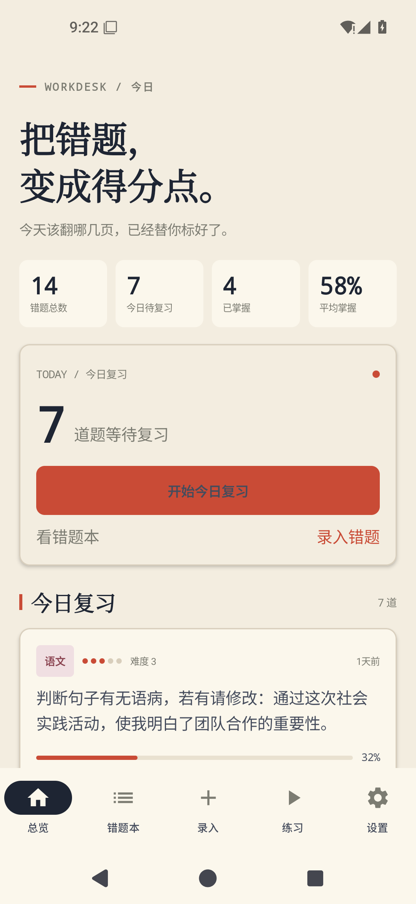
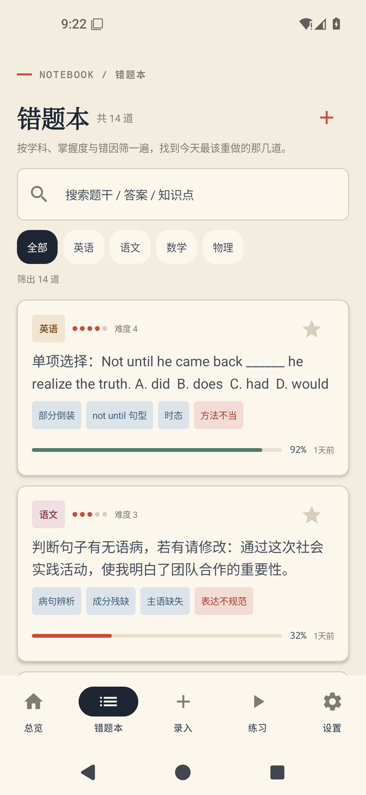
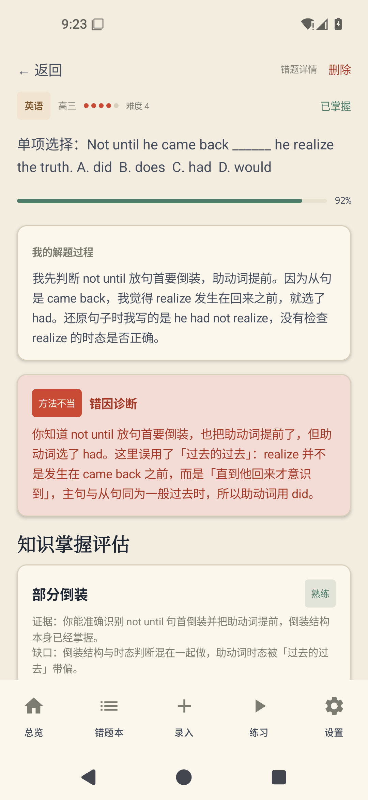
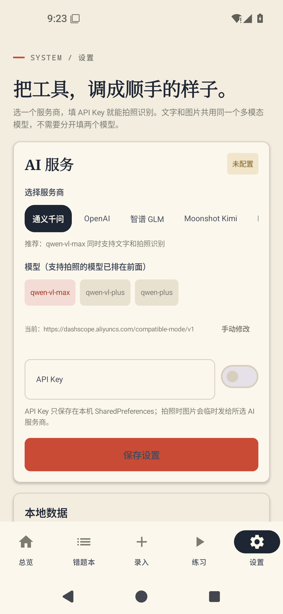
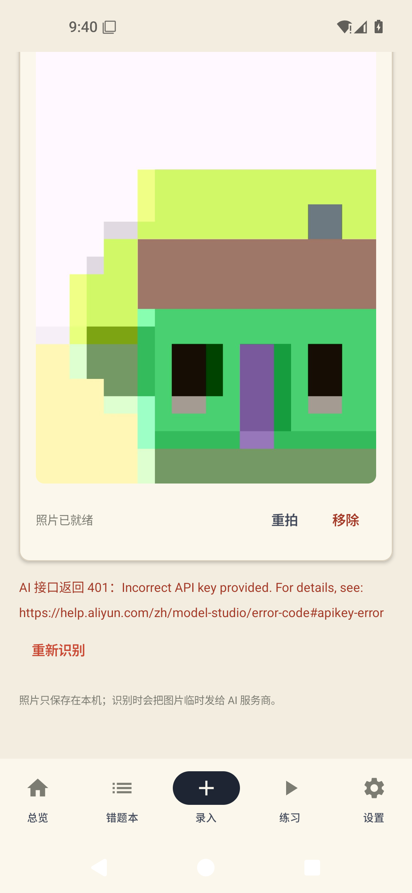
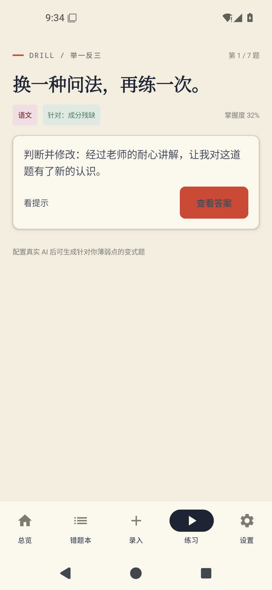
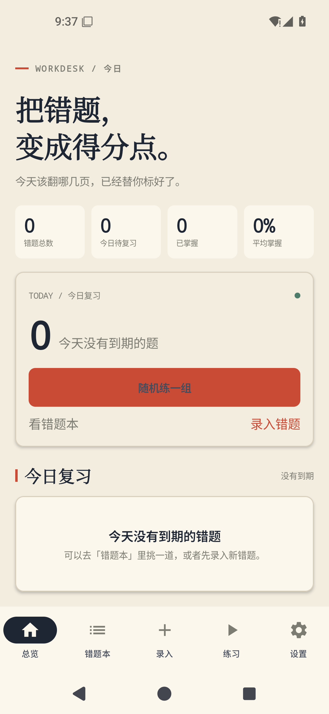

# 知错 Android 0.4.0 模拟器运行验证

> 验证日期：2026-11-05
> 验证对象：`zhicuo-android-0.4.0.apk`（versionCode 4 / versionName 0.4.0，9,850,437 字节）
> SHA256：`13D5A37927E6F6B29EDE2E15A2545E591D5AB45213F88362DB801B6C7797325A`

## 环境

| 项 | 值 |
|---|---|
| 主机 | Windows，Intel i5-8250U / 7.8 GB RAM，AEHD 硬件加速可用 |
| 模拟器 | Android Emulator 36.6.11 |
| 系统镜像 | `system-images;android-35;default;x86_64`（Android 15，AOSP） |
| AVD | `zhicuo_test`（Pixel 5 轮廓，1080×2340，headless） |
| 安装方式 | `adb install -r`，debug 签名 |
| 自动化脚本 | `scripts/android-emulator-check.ps1` |

## 验证结果

| # | 检查项 | 结果 | 说明 |
|---|---|---|---|
| 1 | 安装 / 启动 | ✅ | `MainActivity` 正常拉起，无 `FATAL EXCEPTION` |
| 2 | 首页渲染 | ✅ | 14 道种子题、7 待复习、4 已掌握、58% 平均掌握；今日复习卡片与最近录入正常 |
| 3 | 错题本 | ✅ | 14 道列表、学科筛选、搜索框、知识点标签、掌握度条、收藏星标 |
| 4 | 错题详情 | ✅ | 题干、我的解题过程、错因诊断、知识掌握评估、答案与解析、删除入口 |
| 5 | 设置：服务商预设 | ✅ | 通义千问 / OpenAI / 智谱 / Kimi / DeepSeek / 自定义；选服务商自动带出地址与推荐多模态模型 |
| 6 | 设置：保存 API Key | ✅ | 保存后状态标签变「已配置」，Key 仅存本机 SharedPreferences |
| 7 | 拍照录入 | ✅ | 系统相机 → 拍照 → 确认 → 回到 App 显示照片；`files/images/q_*.jpg` 生成（29 KB，已压缩），相机临时文件已清理 |
| 8 | AI 请求链路 | ✅（鉴权错误符合预期） | 用**假 Key** 实测：请求成功发到 DashScope 兼容接口，返回 `401 Incorrect API key provided` 并在界面显示「AI 接口返回 401：Incorrect API key provided…」+「重新识别」按钮；证明请求构造 / 图片 base64 / 错误处理均正常 |
| 9 | 导出 PDF | ✅ | 生成 694,837 字节、`%PDF-1.4`、6 页的 A4 练习卷（题目页 + 答案解析页），系统分享面板可发送/打印 |
| 10 | 举一反三 | ✅ | 今日到期队列 7 题；变式题显示「针对：知识点」；看提示 / 查看答案 / 三档自评 |
| 11 | 掌握度更新 | ✅ | 自评「已掌握」后 q_014 从 32% → 48%，错题本排序与「刚刚」时间同步刷新 |
| 12 | 清空内置示例题 | ✅ | 二次确认后 14 道示例清空，首页/错题本进入空态；不影响自己录入的题 |

## 截图

| 首页 | 错题本 | 详情 |
|---|---|---|
|  |  |  |

| 设置（服务商预设） | 拍照 + AI 错误处理 | 练习 |
|---|---|---|
|  |  |  |

| 清空示例后的空态 |
|---|
|  |

## 未覆盖项

- **真实 AI 识别结果**：验证时没有可用 API Key，只用假 Key 验证了请求链路与错误提示；真实识别需在手机上填入自己的 Key 后测试（推荐通义千问 `qwen-vl-max`）。
- **真机相机**：模拟器使用虚拟场景，未验证真机对焦、闪光灯、横竖屏。
- **系统分享目标**：模拟器无微信/QQ，只验证到系统分享面板出现 PDF。
- **多张照片 / 一页多题**：当前版本一题一图，需分多次拍。

## 复现命令

```powershell
# 前置：JDK 17 + Android SDK + system-images;android-35;default;x86_64 + emulator
powershell -NoProfile -ExecutionPolicy Bypass -File scripts\android-emulator-check.ps1 -Headless
```

脚本会：创建/复用 AVD → 启动模拟器 → 等待开机 → 安装 APK → 启动 App → 截图 + UI dump + crash 日志，输出到 `dist/android-check/`。

## 验证中发现并修复的问题

1. `AddScreen` 相册回调使用 `MainScope()` 泄漏协程 → 改为 `rememberCoroutineScope()`。
2. 照片压缩失败时无提示 → 增加「照片处理失败，请重新拍一张」。
3. AI 错误信息直接展示整段原始 JSON → 提取 `error.message` 展示为「AI 接口返回 401：Incorrect API key provided…」。
4. 拍照流程文案仍写「视觉模型」→ 统一为「多模态模型」。
